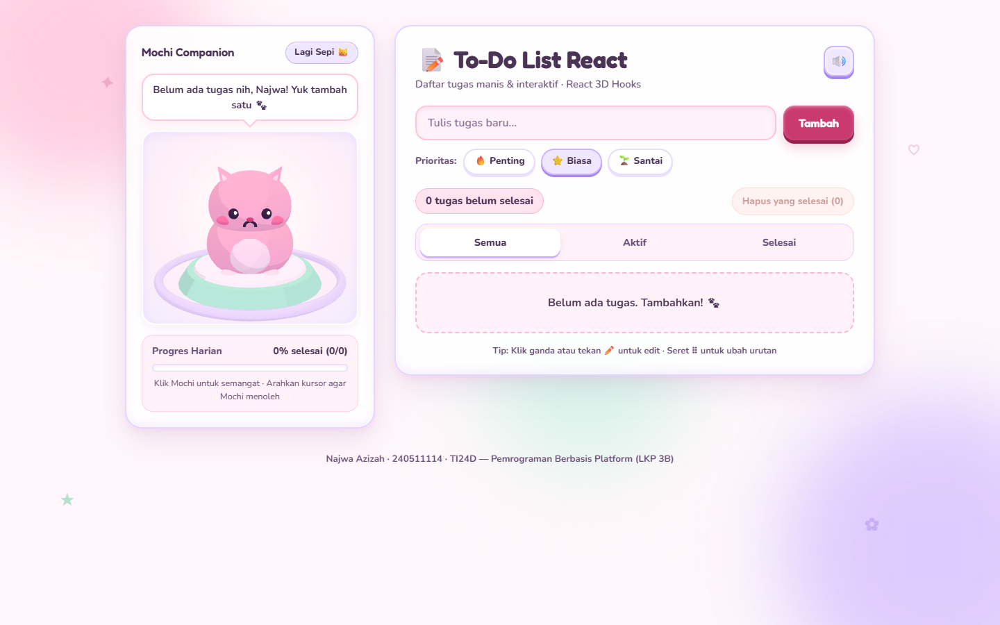
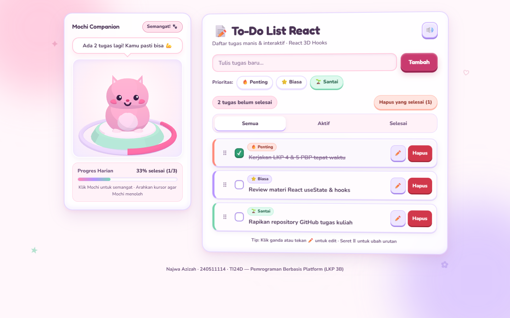
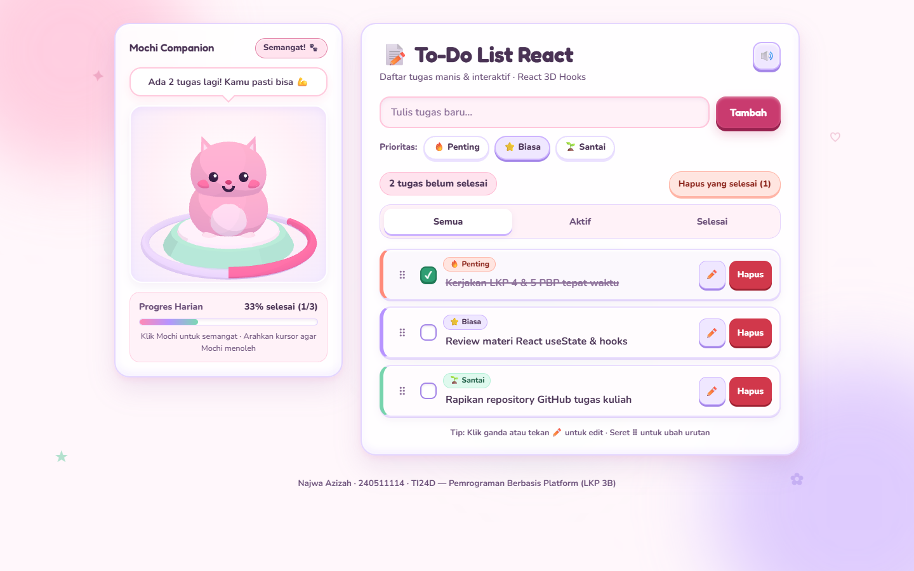
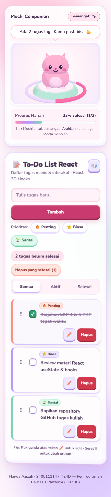

# LKP 3B — Aplikasi To-Do List dengan React, Hooks & 3D (Vite) ⚛️🐾

Tugas praktikum **Pertemuan 5: React Fundamentals** mata kuliah **Pemrograman Berbasis Platform** (Program Studi S1 Teknik Informatika, Universitas Muhammadiyah Cirebon). Mengkonversi aplikasi To-Do List LKP 3A menjadi arsitektur **React berbasis komponen**, **props**, **`useState`**, **`useEffect`**, **React Three Fiber**, dan **Framer Motion**.

## Identitas Mahasiswa
- **Nama**: Najwa Azizah
- **NIM**: 240511114
- **Kelas**: TI24D

---

## Teknologi yang Digunakan
- **React 19** (`react` & `react-dom` `^19.3.1`) + **Vite** (`^8.3.6`)
- **Three.js** (`^0.187.0`), **`@react-three/fiber`** (`^9.8.2`), **`@react-three/drei`** (`^10.7.9`)
- **Framer Motion** (`^14.14.0`) untuk animasi list & drag-reorder
- **Oxlint** (`^1.90.0`) untuk pemeriksaan kualitas kode

---

## Struktur Komponen & Folder

```text
lpk-3b/
├── index.html                      # Entry HTML (Google Fonts Fredoka & Nunito, favicon SVG)
├── package.json
├── vite.config.js
├── README.md                       # Dokumentasi project LKP 3B
├── screenshots/                    # Dokumentasi hasil uji desktop & mobile
│   ├── 01-kosong-desktop.png
│   ├── 02-berisi-desktop.png
│   ├── 03-setelah-refresh-desktop.png
│   └── 04-berisi-mobile.png
└── src/
    ├── main.jsx                    # Mount React dengan React.StrictMode
    ├── App.jsx                     # State utama (todos, filter, muted, celebrateKey), localStorage & layout
    ├── App.css                     # Design system pastel kawaii 3D claymorphism & responsivitas
    ├── components/
    │   ├── TodoForm.jsx            # Form input tugas baru & pemilih prioritas
    │   ├── TodoStats.jsx           # Statistik "X tugas belum selesai" & tombol hapus yang selesai
    │   ├── TodoList.jsx            # List tugas dengan AnimatePresence & Reorder.Group
    │   ├── TodoItem.jsx            # Item tugas (checkbox, stiker prioritas, edit inline, drag handle)
    │   ├── FilterBar.jsx           # Filter Semua / Aktif / Selesai (aria-pressed)
    │   └── Mascot3D.jsx            # Maskot Kucing Mochi 3D & Cincin Progres (React Three Fiber + ErrorBoundary)
    └── utils/
        ├── confetti.js             # Efek partikel confetti pastel pada canvas overlay
        ├── constants.js            # Konfigurasi prioritas, filter, pesan penyemangat & muatTodos()
        └── sound.js                # Efek suara pop WebAudio API
```

---

## Fitur Utama

### 1. Kepatuhan Rubrik React Fundamentals
- **Pemisahan Komponen**: Terdiri dari 4 komponen utama modul (`TodoForm`, `TodoStats`, `TodoList`, `TodoItem`) ditambah `FilterBar` dan `Mascot3D` (dimuat secara *lazy* via `React.lazy` + `Suspense`).
- **Aliran Data `props`**: State dan handler (`onTambah`, `onToggle`, `onHapus`, `onEdit`, `onUrutkan`, `onMoveByStep`, `onHapusSelesai`, `onFilterChange`) mengalir bersih dari parent (`App`) ke child.
- **State & Side Effect (`useState` + `useEffect`)**:
  - `todos` dan `muted` diinisialisasi menggunakan *lazy initializer* `useState(() => muatTodos())` dan disinkronkan ke `localStorage` via `useEffect`.
  - Pola *lazy initializer* mencegah data `localStorage` terhapus oleh *double-mount* `React.StrictMode` pada mode development.

### 2. Fitur 3D, Animasi & Interaktif
- **Maskot Kucing Mochi 3D (`Mascot3D.jsx`)**:
  - Dibangun dengan `@react-three/fiber` (`<Canvas>`) dan `@react-three/drei` (`<Float>`).
  - Bereaksi terhadap `mood` (`empty`, `busy`, `happy`), `progress` (cincin torus 3D di sekeliling alas), `celebrateKey` (lompat + putar saat tugas diselesaikan), dan `pokeKey` (*squish* saat diklik).
  - Dilengkapi pengecekan dukungan WebGL dan `WebGLErrorBoundary` yang otomatis menampilkan fallback CSS (`🐱`) jika WebGL gagal.
- **Animasi & Reorder Halus**: `AnimatePresence` untuk animasi masuk/keluar item dan `Reorder.Group` / `Reorder.Item` dengan `useDragControls` pada pegangan `⠿` (serta `ArrowUp` / `ArrowDown` lewat keyboard).
- **Fitur Lengkap Lainnya**: Filter (`Semua` / `Aktif` / `Selesai`), prioritas (`🔥 Penting`, `⭐ Biasa`, `🌱 Santai`), edit inline (`double-click` / tombol `✏️`), hapus yang selesai, confetti & suara pop (`🔊`/`🔇`), serta dukungan `prefers-reduced-motion`.

---

## Cara Menjalankan

```bash
# 1. Masuk ke folder project
cd lpk-3b

# 2. Install dependencies
npm install

# 3. Jalankan server development
npm run dev
```

Buka `http://localhost:5173/` di browser.

### Perintah Lainnya
```bash
npm run lint      # Jalankan pemeriksaan Oxlint
npm run build     # Build produksi ke folder dist/
npm run preview   # Preview hasil build produksi
```

---

## Screenshot Pengujian

| Kondisi Kosong (Desktop 1440×900) | Berisi 3 Tugas & 1 Selesai (Desktop) |
| :---: | :---: |
|  |  |

| Setelah Refresh — Data Persist (Desktop) | Tampilan Responsif (Mobile 390×844) |
| :---: | :---: |
|  |  |
